# Multi-Cloud Secure IaC

[](https://github.com/Subash-1507/multicloud-secure-iac/actions/workflows/security-scan.yml)
[](https://sonarcloud.io/summary/new_code?id=Subash-1507_multicloud-secure-iac)
[](https://sonarcloud.io/summary/new_code?id=Subash-1507_multicloud-secure-iac)

Secure-by-default infrastructure for **AWS and Azure**, provisioned with **Terraform**, configured with **Ansible**, and gated by an automated **DevSecOps pipeline**. Nothing reaches `main` without passing SAST, IaC misconfiguration scanning, secret detection and linting.

> 📄 **Case study:** [How I hardened this pipeline's tool supply chain](docs/case-studies/01-ci-supply-chain-hardening.md): SonarQube security rating C → A, hash-verified dependencies, 10/10 CI gates.

## How it works

**1. Every change goes through the security pipeline before it can reach `main`:**

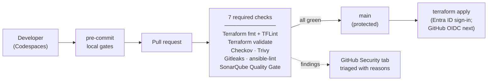

**2. What is deployed on Azure, and how the pieces trust each other:**

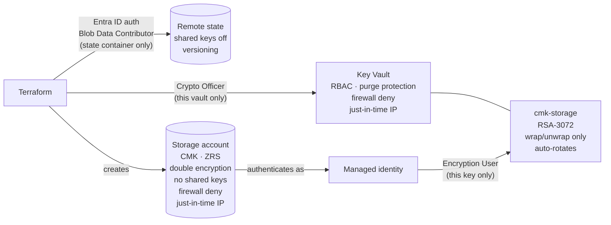

**3. How GitHub Actions signs in to Azure: no secrets, and nothing deploys without approval:**

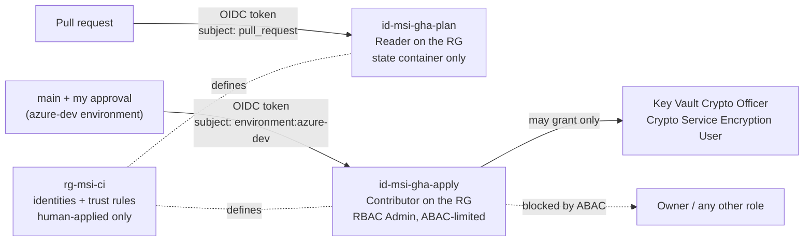

The AWS module (S3 + KMS customer-managed key) is written and scanned; deploying it is blocked by the AWS account's Organizations SCP.

## Status

| Part | State |
|---|---|
| CI security gates (7 required checks, protected `main`) | ✅ Done |
| Hash-locked tool supply chain | ✅ Done ([case study](docs/case-studies/01-ci-supply-chain-hardening.md)) |
| Codespaces dev container with `make scan` | ✅ Done |
| AWS secure storage module (S3 + customer-managed KMS key) | ✅ Written and scanned · ⛔ deploy blocked by the account's AWS Organizations SCP |
| Ansible `baseline_hardening` role | ✅ Written and linted · 🚧 not yet run on a host |
| AWS network + EC2 over SSM | 🚧 In progress |
| Azure dev environment (resource group, remote state with Entra ID auth, no keys) | ✅ Deployed |
| Azure Key Vault + customer-managed key (RBAC, purge protection, firewall, auto-rotation) | ✅ Deployed |
| Azure storage account encrypted with the customer-managed key (ZRS, double encryption, no shared keys, firewall) | ✅ Deployed |
| Azure Linux VM hardened by Ansible | 🗓️ Planned |
| GitHub OIDC identities: federated credentials, least-privilege roles, ABAC-limited role delegation | ✅ Deployed |
| Just-in-time firewall access (`scripts/azure-firewall-ip.sh`) | ✅ Done |
| GitHub Actions plan/apply workflow with an approval gate | 🚧 In progress |

## Evidence

**Every security gate passes locally before code is pushed** (`make scan`):

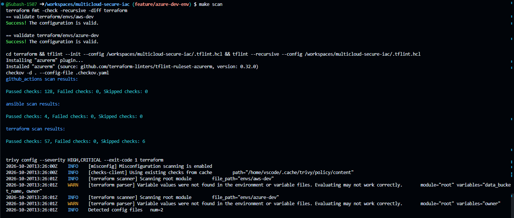
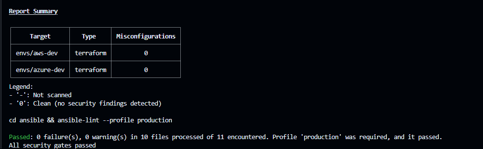

**SonarQube Cloud Quality Gate: passed, security rating A.** The one counted issue is an accepted, documented risk (`0644` on an apt config file):

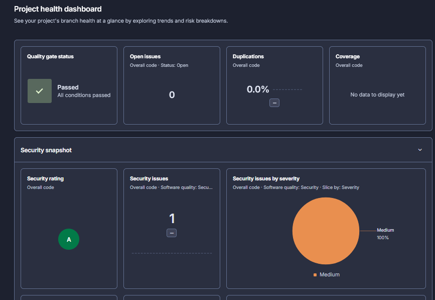

**Control plane vs data plane on Azure.** As subscription Owner I could create the state container but not read it, until I granted *Storage Blob Data Contributor* scoped to that single container:

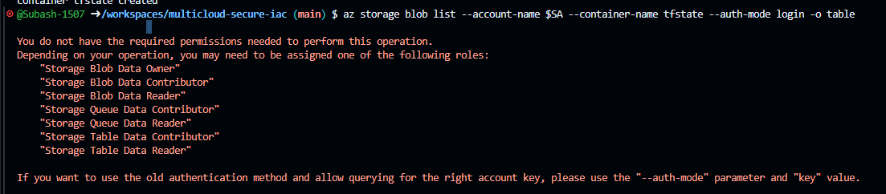
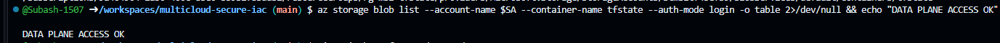

**Hardened Terraform state storage:** account keys and anonymous blob access disabled, HTTPS only, TLS 1.2 minimum:

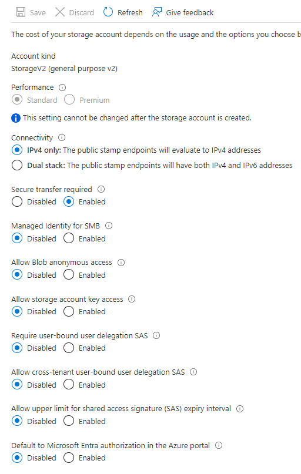
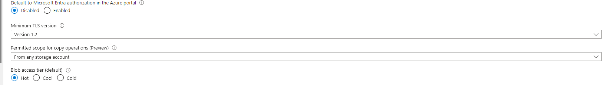

**Key Vault holding a customer-managed key**, deployed with Terraform: RBAC permission model, purge protection, firewall denying everything except one IP, and an RSA-3072 key limited to wrap/unwrap:

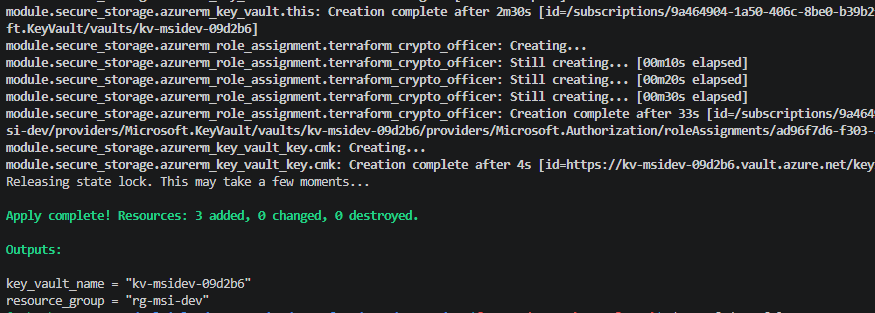
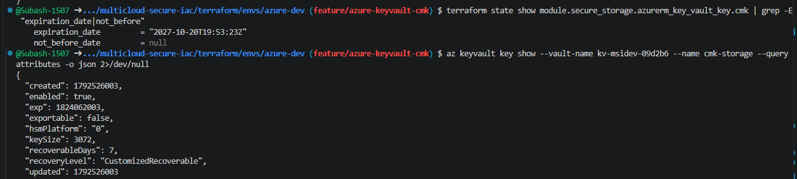
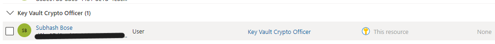
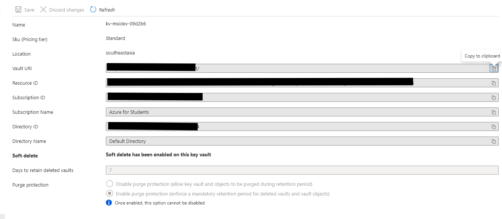

**Checkov blocked the new storage account with 5 findings.** I fixed one (LRS to ZRS) and recorded four as accepted risk, not applicable or false positive, plus geo-replication accepted for data residency:

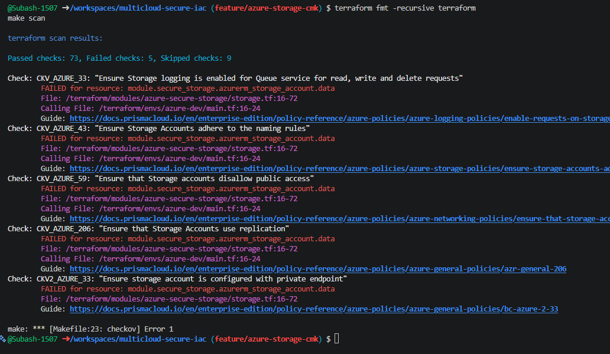
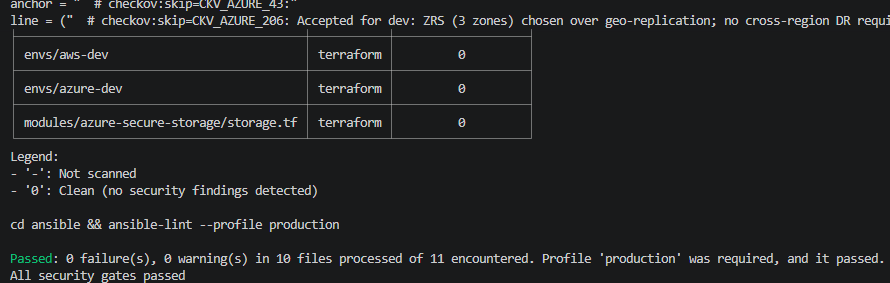

**Storage encrypted with my customer-managed key** (envelope encryption): key source Key Vault, the versionless key resolved to the current version, infrastructure encryption on, zone-redundant, shared keys disabled, firewall Deny:

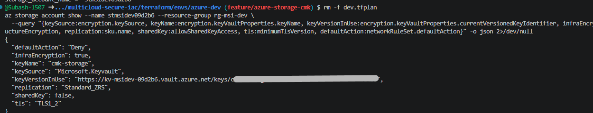

## How a change reaches `main`

```
 developer ──► pre-commit (fmt, validate, TFLint, Gitleaks, ansible-lint)
     │
     ▼ pull request (direct pushes to main are blocked)
 GitHub Actions: security-scan.yml
 ├─ Terraform fmt + TFLint ─────────── style, provider-specific mistakes
 ├─ Terraform validate (per env) ───── syntax, types, module wiring
 ├─ Checkov ───────────────────────┐  Terraform, Ansible, workflow and secret checks
 ├─ Trivy config (tfsec successor) ┴─► SARIF ─► GitHub Security tab
 ├─ Gitleaks ───────────────────────── secrets anywhere in git history
 ├─ ansible-lint (production) ──────── playbook and role quality
 └─ SonarQube Cloud ────────────────── SAST + IaC rules + dependency risks; Quality Gate blocks merge
     │ all 7 green
     ▼
 main ──► terraform plan/apply via GitHub OIDC (identities deployed; workflow in progress)
```

## Target architecture

```
 AWS (ap-south-1)                          Azure (Southeast Asia)
 ├─ S3 data bucket                         ├─ Storage account
 │   SSE-KMS, customer-managed key         │   CMK in Key Vault, shared keys off
 │   TLS 1.2+ only, no public access       │   TLS 1.2+, no public blob access
 ├─ S3 access-log bucket                   ├─ Key Vault (RBAC, purge protection)
 └─ EC2 hardened by Ansible over SSM       └─ Linux VM hardened by Ansible
     (no inbound ports, no SSH keys)
```

## Security controls

| Control | AWS | Azure |
|---|---|---|
| Encryption at rest | SSE-KMS, customer-managed key, yearly rotation | Customer-managed key in Key Vault |
| Encryption in transit | Bucket policy denies non-TLS and TLS < 1.2 | `min_tls_version = TLS1_2`, HTTPS only |
| Public exposure | Block Public Access on, ACLs disabled | Public blob access off |
| Admin access | SSM Session Manager, no port 22 | Bastion / NSG allowlist |
| Host baseline | Ansible `baseline_hardening` role | Same role |
| CI credentials | GitHub OIDC to an IAM role | GitHub OIDC to user-assigned managed identities (federated credentials, no secrets) |
| Network access to secrets | n/a | Key Vault and storage firewalls default Deny; IPs added just in time, never in code |
| State | S3 backend, encrypted, native locking | azurerm backend, Entra ID auth |

## CI access to Azure (GitHub OIDC)

GitHub Actions never holds an Azure secret. Each run gets a short-lived token from GitHub, and Azure accepts it only if its **subject** matches a federated credential:

| Identity | Who can use it | What it can do |
|---|---|---|
| `id-msi-gha-plan` | Pull requests (`repo:…:pull_request`) | Read the resource group; read and lock the state blob. Cannot change anything. |
| `id-msi-gha-apply` | Only the `azure-dev` environment (`repo:…:environment:azure-dev`), which requires my approval and runs only from `main` | Manage resources in one resource group; grant **only** the two Key Vault roles |

**Why the apply identity cannot escalate:** Terraform must create the Key Vault role assignments, so the identity has *Role Based Access Control Administrator*. On its own, that role could grant itself Owner. An **ABAC condition** limits it to assigning or removing *Key Vault Crypto Officer* and *Key Vault Crypto Service Encryption User*. Every other role is denied by Azure itself. *Contributor* cannot grant roles, so the identity's reach stays inside one resource group, behind an approval.

**Why the pipeline cannot change its own access:** both identities, their trust rules and their role assignments live in a separate resource group, `rg-msi-ci`, managed by its own Terraform root (`terraform/envs/azure-ci`) with its own state. Only a human applies that root. CI has no role on `rg-msi-ci`, so even an approved pipeline run cannot add a trust rule or widen its own permissions.

**Just-in-time network access:** the Key Vault and the storage account deny all networks. Terraform ignores their IP lists, so no IP is ever committed. `scripts/azure-firewall-ip.sh` adds the caller's current IP before work and removes it after (`add`, `remove`, `reset`, `list`). The CI apply job will do the same and always remove the runner's IP, even on failure.

**Accepted risk, documented inline:** SonarQube rule S6381 flags the *Contributor* assignment. It is scoped to one resource group, usable only from the approval-gated environment, and cannot be used to grant roles. The decision sits next to the code as a `NOSONAR` comment with its reason.

## Pipeline supply-chain security

The tools that check the code are secured too:

- **GitHub Actions pinned to commit SHAs**, not tags; Dependabot proposes updates.
- **Python tools hash-locked:** `requirements-*.in` lists what we need, and `pip-compile --generate-hashes` produces `requirements-*.txt` with every package pinned and SHA-256 verified.
- **Installs use `--require-hashes --only-binary :all:`**, so no tampered file and no third-party `setup.py` can run.
- **Downloads are HTTPS-only with TLS 1.2+**, and redirects can't downgrade them.
- **Least-privilege workflow permissions:** read-only by default, write only where a job uploads results.

## Repository layout

```
.github/workflows/security-scan.yml   PR and main security gates
.github/dependabot.yml                weekly updates for Actions, Terraform and pip
.devcontainer/                        Codespaces environment with every scanner installed
terraform/modules/<cloud>-<purpose>/  reusable, secure-by-default modules
terraform/envs/<cloud>-<env>/         thin root modules: backend, providers, module calls
terraform/envs/azure-ci/              CI identities for GitHub OIDC; applied by a human only
ansible/harden.yml                    playbook: applies baseline_hardening to all hosts
ansible/roles/baseline_hardening/     OS hardening role (SSH, sysctl, auditd, ufw, updates)
ansible/inventories/dev/              dynamic inventories, no hardcoded IPs
requirements-*.in / requirements-*.txt  tool versions / hash-locked lock files
docs/case-studies/                    write-ups of real problems and how they were solved
docs/decisions/                       architecture decision records (ADRs)
scripts/azure-firewall-ip.sh          just-in-time firewall access for the dev Key Vault and storage
Makefile                              `make scan` runs every CI gate locally
```

## Getting started

Open the repo in **GitHub Codespaces** (Code → Codespaces → Create codespace on main). The dev container installs Terraform, TFLint, Checkov, Trivy, ansible-lint and pre-commit. Then run every CI gate locally:

```bash
make scan
```

To work on a change:

```bash
git switch -c feature/my-change
# edit, then
make scan
git commit -am "Describe the change"   # pre-commit runs the local gates
git push -u origin feature/my-change
gh pr create
```

### Updating tool versions

Edit the `.in` file, then regenerate its lock file:

```bash
pip-compile --generate-hashes --allow-unsafe --output-file requirements-ci.txt requirements-ci.in
pip-compile --generate-hashes --allow-unsafe --output-file requirements-dev.txt requirements-dev.in
```

### Deploying the Azure dev environment

```bash
az login
scripts/azure-firewall-ip.sh reset      # allow only your current IP, just in time
cd terraform/envs/azure-dev
cp backend.hcl.example backend.hcl && cp terraform.tfvars.example terraform.tfvars   # fill in; both are git-ignored
terraform init -backend-config=backend.hcl
terraform plan -out=dev.tfplan          # review: nothing should be destroyed
terraform apply dev.tfplan && rm dev.tfplan
../../../scripts/azure-firewall-ip.sh remove
```

The AWS dev environment is written and validated, but its deployment is blocked by the account's Organizations SCP.

## Suppression policy

Scanner findings are fixed, not hidden. When a check genuinely does not apply, it is suppressed **inline, next to the code, with a reason**, for example:

```hcl
# checkov:skip=CKV_AWS_145: S3 server access log delivery requires SSE-S3 on the target bucket
role_definition_name = "Contributor" # NOSONAR(terraform:S6381): one RG, approval-gated env only; ...
```

Every suppression is reviewed in the pull request like any other code.

## Author

**Subash Chandra Bose**: DevOps, Cloud & Security Engineer · Microsoft Certified (SC-500, AZ-104, SC-200)
[Portfolio](https://subash-1507.github.io) · [LinkedIn](https://www.linkedin.com/in/subash-chandra-bose-014bb21b5) · [GitHub](https://github.com/Subash-1507)
